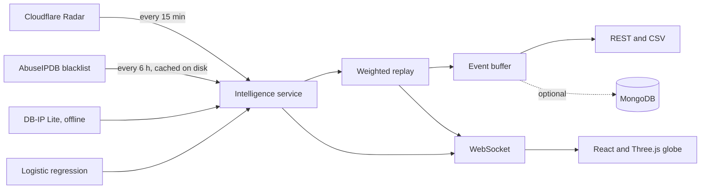

# Global DoS Attack Map

[](https://github.com/AaronRaj06/DDOS-AttackMap/actions/workflows/ci.yml)

A real-time globe of denial-of-service trends. It replays country-to-country attack routes from
[Cloudflare Radar](https://radar.cloudflare.com/), plots abusive IPs from
[AbuseIPDB](https://www.abuseipdb.com/) at their approximate location, and can train a classifier
that ranks which of those IPs are likely DoS sources.

It runs without any API keys in a clearly labeled demo mode. For a guided walk through how it works,
open `/tour` (see [The tour](#the-tour)).


## What is real

| On screen | Source | What it means |
|---|---|---|
| Arcs and route shares | Cloudflare Radar, last 24 hours, refreshed every 15 minutes | Samples of country-level trends, weighted by share. An arc is not one live attack. |
| Attack vectors | Cloudflare Radar | Share of network-layer attacks by technique, and how each share moved against the week before. |
| Spike status and timeline | Cloudflare Radar timeseries, every 15 minutes | A statistical estimate from the last 2 to 3 days of traffic. It is not a Cloudflare alert, and Radar data lags by up to about 15 minutes. |
| Top targets, attack duration and bitrate | Cloudflare Radar, last 24 hours | Separate lists. Layer 3 has no origin-to-target pairs, so they are never joined. |
| Dots | AbuseIPDB blacklist, refreshed every 6 hours | IPs reported for any kind of abuse, shown as /24 or /48 networks. |
| Red dots | The classifier | IPs the model ranks as likely DoS sources. Only shown after you train it. `GET /threats/{network}` says which factors pushed a network up or down. |
| IP lookup | DB-IP Lite databases on disk | Approximate, often only city-level, and wrong for mobile or proxied addresses. Nothing is sent to a third party. |
| Timeline replay | The same Radar timeseries | Shows how much and when. Radar's timeseries has no routes, so the map does not change during a replay. |
| Demo mode | Built-in illustrative routes | Made up. Always labeled as demo. |

Network-layer origins are the Cloudflare data center country that received the traffic, because
source IPs in those attacks can be spoofed. Radar publishes no IPs and AbuseIPDB publishes no
victims, so the two datasets are drawn separately and never joined into fake attacker-to-victim pairs.

## Architecture



- **Backend:** Node.js, Express 5, `ws`, optional MongoDB through Mongoose
- **Frontend:** React 19, Vite, Three.js
- **ML:** logistic regression in plain JavaScript, trained offline
- **Delivery:** one Docker image serving the API, WebSocket and UI, with a GitHub Actions pipeline

## Using the dashboard

- **Status tiles:** threat status (an icon and a word: Normal, Elevated, Spike or No data), the top origin
  and how old the data is. Ages tick, and screen readers are not told about the ticks.
- **Globe and flat map:** hover or click an arc or a dot for a card. A route card shows its layer and
  share. A network card shows the country, ASN and score, and the three factors behind the score. Switch to
  a flat map from the header. Without WebGL the flat map is shown for you.
- **Dots:** reported IPs are discs and likely DoS sources are rings, so the difference never depends on
  colour. Zoomed out they merge into a glow that shows density.
- **Lists:** every card is also reachable from the lists beside the map, so nothing needs a pointer.
  Hovering or focusing a route in the list outlines it on the map.
- **Timeline:** Radar traffic per layer for 3 days, with spikes as a shaded band, a triangle and a
  button. Pick one to replay it.
- **Panels:** where attacks land, week-over-week vectors, attack size, an offline IP lookup and a model
  card. They collapse, and they are remembered.
- **On a phone:** the header actions move into a menu and the panels into a bottom sheet.

### Filters and links

Layer, flagged-only and a watchlist of countries filter every list and every new arc. They need no
server calls and are saved in this browser. A link overrides what was saved, one setting at a time.

| Parameter | Values | Example |
|---|---|---|
| `layer` | `l3` or `l7` | `?layer=l7` |
| `country` | up to 20 ISO country codes | `?country=DE,FR` |
| `flagged` | `1` | `?flagged=1` |
| `kiosk` | `1` | `?kiosk=1` |

Anything else is ignored and never reaches the page. `?kiosk=1` hides the controls and the sidebar for a
wall display: larger numbers, auto-rotation, and a cursor that hides when idle. Escape leaves it.

### Keyboard

| Key | Does |
|---|---|
| Tab | Moves in visual order. The first stop is a skip link. |
| Arrow keys, `+`, `-` on the globe | Rotate and zoom |
| Space on the globe or the flat map | Pause or resume |
| Enter on a list row | Opens its card and moves focus there |
| Escape | Closes the card, the menu or the sheet, and returns focus. In kiosk mode it leaves kiosk. |
| Arrow keys, Enter, Escape in the country picker | A standard combobox |

**Reduce motion** follows your system setting until you switch it in the header. It stops
auto-rotation and arc animation, and arcs appear whole.

### What is stored in your browser

Only these, all local, never sent anywhere: your filters and watchlist, the globe or map choice, the
motion setting, which panels are open, which notices you dismissed and the last data mode seen.

### Design system

[docs/design-system.md](docs/design-system.md) has the tokens, the measured contrast and colour-blind
separation, and the accessibility rules. `frontend/src/styles/tokens.css` is the only place a colour is
defined, and a test fails if a stylesheet uses a raw one.

## The tour

`/tour` is a scroll-driven explainer for people seeing the project for the first time. The globe draws
itself in, then each scene follows the data: invented arcs (what most attack maps show), Radar routes and
the network-layer origin, AbuseIPDB networks, the classifier and its factors, the two layers that never
join, spike detection with a replay and its outputs, how it is built, and a hand-off to the live map.

- **Live or illustrative, per scene.** Every scene that draws data has its own badge. It says `live` only
  when that scene's data came from the server: Radar arcs from Radar, dots from the blacklist, factors from
  `GET /threats/{network}`, the ribbon from `GET /timeline`. Anything else is a built-in example and says
  `illustrative`. The invented arcs are stamped as invented.
- **Without WebGL, or with reduced motion,** the same content is a single readable page with labelled
  diagrams. With reduced motion there is an "Enter 3D anyway" button; inside 3D, the camera then cuts
  instead of gliding.
- **Budget:** the tour's own code is about 16 kB gzipped, on top of the Three.js the dashboard already
  loads. Measured at 60 fps in every scene on an Apple M1 (integrated GPU) at 1440x900. It draws at most
  2,000 dots, 800 on a phone, and caps the pixel ratio at 1.5.

**Editing it.** Every word is in `frontend/src/tour/content.js`, which both the 3D scenes and the 2D page
read. The claims there match this README, so change them together. The examples on the output cards are
checked against the server's own formatters by `frontend/test/tour.test.js`.

**Adding a scene.** Add an entry to `steps` in `content.js` (a `nav` label puts it in the step bar). Then
add `frontend/src/tour/scenes/<Name>.jsx`, register it in `SCENES` in `frontend/src/tour/Stage.jsx`, and
either give it a camera view in `VIEWS` there or move the camera itself with `globe.current.setView()`.
A scene's effects run only while it is `active` and must undo what they drew. `scenes/Built.jsx` is the
simplest example; `scenes/Separate.jsx` shows drawing your own shapes with `globe.current.add()`.

## Quick start

Needs Node.js 22.12 or newer.

```bash
cd backend
npm ci
cp .env.example .env     # keys are optional
npm run geo:update       # optional: city-level IP location, about 65 MB download
npm start                # http://127.0.0.1:5050
```

In a second terminal:

```bash
cd frontend
npm ci
npm run dev              # http://127.0.0.1:5173
```

To serve everything from port 5050, run `npm run build` in `frontend` and restart the backend.

### Docker

```bash
docker compose up --build --detach --wait
docker compose run --rm app node scripts/updateGeo.js   # optional
docker compose restart app                              # load the new database
```

## Configuration

Set these in `backend/.env`.

| Variable | Default | Purpose |
|---|---|---|
| `CLOUDFLARE_API_TOKEN` | empty | Custom token with only `Account > Radar > Read`. Never use a Global API Key. |
| `ABUSEIPDB_KEY` | empty | Enables threat dots and training. |
| `ALERT_WEBHOOK_URL` | empty | Slack-compatible `https` webhook told when a spike starts. Checked at startup. Treat it as a secret. |
| `METRICS_TOKEN` | empty | Turns on `GET /metrics` for Prometheus, behind `Authorization: Bearer <token>`. At least 16 characters. |
| `MONGODB_URI` | empty | Keeps replayed events for 3 days and restores them on restart. |
| `PORT` | `5050` | 5000 is taken by AirPlay on macOS. |
| `HOST` | `127.0.0.1` | Docker sets `0.0.0.0`. |
| `ALLOWED_ORIGINS` | empty | Other sites allowed to open the WebSocket. Same origin always works. |
| `TRUST_PROXY` | `0` | Number of reverse proxies in front. Set it correctly or rate limits apply to the proxy's IP. |

If you change `PORT`, start Vite with `BACKEND_URL=http://127.0.0.1:<port> npm run dev`.

## Spike detection

Radar's layer 3 and layer 7 timeseries (15-minute buckets, 2 days per request) are kept in memory
for 3 days, and in MongoDB for 7 days if it is configured.

- **Score:** a robust z-score, using the median and MAD of the previous 24 hours, on a log scale.
  Traffic noise is multiplicative, and on raw values ordinary bursts looked like attacks.
- **Enter:** 2 points in a row at z >= 3.5, or 1 point at z >= 6. **Exit:** z < 2, so a noisy plateau
  stays one spike. Points inside a spike are kept out of the baseline.
- **Status:** `spike` while one is running, `elevated` while the latest point is at z >= 2, `normal`
  otherwise, and `unavailable` with fewer than 24 baseline points or without a Radar token.
- **Gaps** longer than 3 normal intervals end a running spike and are never filled in.
- **Each spike reports** its start, end, peak z-score, its size as a ratio to normal, and `baseline`:
  the typical level it was measured against, in the series' own units.

Measured on simulated series, not real attacks (`npm run spikes:simulate`, 300 series per row):

| Noise | Series with a false alarm | 3x surge for 2 h found | 2x surge for 90 min found |
|---|---|---|---|
| gaussian, 15% | 0 | 100% | 96% |
| daily cycle of 25% plus 10% noise | 0 | 100% | 60% |
| skewed (log-normal, sigma 0.3) | 0 | 75% | 10% |

Quiet series stay quiet, but on bursty traffic the detector misses moderate surges, because bursts
that size are ordinary there. Real Radar traffic may behave differently, so treat the thresholds in
`services/spikes.js` as starting values.

## Alerts

Set `ALERT_WEBHOOK_URL` and run `npm run alert:test` to check it. When a spike starts, one
message `{"text": ...}` is posted that names the layer, how far above normal it is and when it
began. It never contains an IP, a key or the webhook itself.

- **One alert per spike**, and at most one per 30 minutes. A spike held back by the cooldown is
  announced afterwards if it is still running. One that ended meanwhile never is.
- **Safe by construction:** the URL comes only from the environment, never from a request. It must
  be `https` with no credentials, and a literal private or loopback address is refused at startup.
  Redirects are not followed, a request times out after 5 seconds, and a failure is retried once.
  A hostname that resolves to a private address is not caught.
- **Failure is quiet:** a dead endpoint never breaks the dashboard, never starts the cooldown, and is
  tried again at the next Radar refresh. Logs say what kind of failure, never the URL.
- **Restarts:** what was announced and when is kept in `backend/.cache/alerts.json`, so a crash loop
  cannot repeat an alert.

## IP lookup

`GET /lookup?ip=` answers entirely from the local databases and the cached blacklist, so it never
spends AbuseIPDB quota. Private, loopback, link-local, documentation, multicast and other reserved
addresses are refused with a clear message, as is anything that is not exactly one IP.

- **Membership is network-wide.** `networkListed` says whether the `/24` or `/48` holds a listed IP,
  never whether this exact address does. A listed address and its unlisted neighbour get identical
  answers, and a test asserts it. An exact answer would let anyone rebuild the blacklist by probing,
  which defeats the masking and probably AbuseIPDB's terms.
- **The score** uses the address's own network, country and ASN. The report-age feature comes from
  the listed network, or, for an unlisted one, is set to the training average and marked
  `basis: neutral_age`. Treat that score as a guess about the network type, not about the address.

## The classifier

**Question:** will this blacklisted IP have a "DDoS Attack" report (AbuseIPDB category 4)?

**Why a model:** labels need one `/check` call per IP and the free tier allows 1,000 a day, while the
blacklist has up to 10,000 IPs. The model scores all of them from data that costs no extra calls.

- **Features:** IP version, country, autonomous system, hosting or access-ISP keywords in the network
  name, and time since the last report. Report categories are the label and are never features.
- **Split:** 70/15/15 by /24 or /48 network, so neighboring IPs cannot leak into the test set.
- **Threshold:** chosen on validation by F0.5, which favors precision. The test set is only reported.
- **Guardrails:** training stops on too little data, and refuses to save a model whose average
  precision is under 1.2 times the positive rate.

```bash
cd backend
npm run geo:update     # required for the network features
npm run ml:collect     # up to 950 labels a run. Run it once a day for a few days
npm run ml:train       # prints held-out metrics and writes ml/model.json
```

### Why a network is flagged

`GET /threats/203.0.113.0%2F24` (or `/threats/203.0.113.0/24`) returns the 3 factors that moved the
score most, each as weight x standardized value, and what the rest add up to. It is exact:
`sigmoid(bias + the three factors + other)` is the score, and a test asserts it. A factor raises or
lowers the score, so "Network name suggests hosting or cloud: raises" is a reason, not a verdict.
When two listed IPs share a network, the higher-scoring one speaks for it. Only the canonical
`a.b.c.0/24` and `x:y:z::/48` forms are accepted, and unknown networks are a 404.

### Model card and retraining

`/health` reports the classifier's `trainedAt`, `ageDays`, sample counts, threshold and held-out
precision, recall, F1 and average precision next to the positive rate it should beat. The state
becomes `stale` after 30 days. A stale model keeps scoring, so the dashboard still works, but
treat its flags with suspicion. Nothing retrains automatically.

Retrain about monthly. Each `ml:collect` run spends up to 950 of the 1,000 daily `/check` calls,
so a 2,000-label dataset takes 2 to 3 days of runs.

No trained model or accuracy figure ships with this repository. Run the steps above and quote the
numbers you get. Scores rank IPs and are not calibrated probabilities. Labels are crowd-sourced
reports, so a missing DDoS report does not prove an IP is innocent.

## API

| Endpoint | Returns |
|---|---|
| `GET /health` | Liveness, data mode, the state of each source and the classifier's model card |
| `GET /events?limit=100` | Recently replayed events |
| `GET /stats` | Counts over the event buffer, plus source status |
| `GET /threats?limit=100` | Masked threat networks with optional scores |
| `GET /threats/{network}` | Why a `/24` or `/48` is flagged: its top 3 factors and a 404 if it is not listed |
| `GET /lookup?ip=8.8.8.8` | Offline location, ASN and organization of one public IP, and the model score if it is active. 30 a minute per client |
| `GET /metrics` | Prometheus text format. Only exists when `METRICS_TOKEN` is set |
| `GET /timeline?layer=l3&limit=100` | Radar series for `l3` or `l7`, with its detected spikes |
| `GET /export?limit=100` | Events as CSV |
| `WS /ws` | `snapshot` on connect, then `event` and `state` messages. Both carry the spike status and the active spikes. |

`limit` accepts 1 to 1000. Data endpoints allow 120 requests a minute per IP. Radar is called 10 times every 15 minutes.

## Monitoring

With `METRICS_TOKEN` set, `GET /metrics` serves Prometheus text format (hand-written, no dependency)
behind a bearer token, compared in constant time and limited to 60 requests a minute. Without the
token the route does not exist.

```yaml
scrape_configs:
  - job_name: dosmap
    authorization: { credentials: <METRICS_TOKEN> }
    static_configs: [{ targets: ['127.0.0.1:5050'] }]
```

| Metric | Use it to alert on |
|---|---|
| `dosmap_radar_last_success_timestamp_seconds` | `time() - x > 3600`: Radar data is stale |
| `dosmap_abuseipdb_last_success_timestamp_seconds` | the blacklist is older than a day |
| `dosmap_source_state{source,state}` | `state="error"` for either source |
| `dosmap_active_spikes{layer}` | a spike is running |
| `dosmap_websocket_clients`, `dosmap_events_replayed_total` | traffic and replay health |
| `dosmap_uptime_seconds`, `dosmap_process_resident_memory_bytes`, `dosmap_process_heap_used_bytes` | restarts and memory growth |

## Tests

```bash
cd backend && npm test
cd frontend && npm run lint && npm test && npm run build
cd frontend && npx playwright install chromium && npm run e2e
```

Upstream APIs are mocked in tests, using the shapes in their published documentation.

`npm run e2e` builds the app and drives it in a real browser against the backend in demo mode: the
page and WebSocket, a non-blank globe, Pause, filters and links, the keyboard, a 320px viewport, the
phone menu and sheet, kiosk, reduced motion, the no-WebGL fallback, every scene of the tour in demo
mode and against a faked live server, and an axe-core accessibility audit of the dashboard and the tour.
CI runs it on every push.

## Before deploying publicly

- Terminate TLS at a reverse proxy and set `TRUST_PROXY`.
- Run one instance. The event buffer, rate limits and quota schedule live in that process and its disk.
- `/health` is a liveness check and stays 200 when a data source fails. Alert on `mode`,
  `radar.state` and `abuse.state` in its body.
- Radar data is licensed for **non-commercial** use. Check AbuseIPDB's terms for your use case too.

## Deploying

`fly.toml` deploys the Docker image to [Fly.io](https://fly.io) as one machine that never sleeps, behind
Fly's HTTPS, with the DB-IP databases built in (`GEO=1`). Fly bills by usage; check
[fly.io/docs/about/pricing](https://fly.io/docs/about/pricing/) before you start.

```bash
brew install flyctl                 # or see fly.io/docs/flyctl/install
fly auth signup                     # or: fly auth login
fly launch --copy-config --no-deploy   # keeps fly.toml; pick another app name if asked
fly secrets set CLOUDFLARE_API_TOKEN=... ABUSEIPDB_KEY=...
fly deploy
fly open /tour
```

**Free option: Render.** `render.yaml` deploys the same image on Render's free plan. In the Render
dashboard choose New → Blueprint, pick this repository, and paste the two keys when asked. The free plan
sleeps after 15 idle minutes (an open dashboard or tour keeps it awake) and takes about a minute to wake.
It has no disk, so each wake downloads the AbuseIPDB blacklist again, which counts against that API's
daily download limit, and spike history starts over, so the spike status stays "unavailable" until it has
run for about six hours without sleeping. Fine for a demo link; use Fly or a paid plan for an always-on map.

Without the two secrets it runs in demo mode, labelled as such. The classifier stays off unless you commit
a trained `backend/ml/model.json`; it holds weights and vocabularies, never an IP address.

## Credits

- Built by the contributors in this repository's
  [commit history](https://github.com/Aakash-legend/DDOS-Attack-Live-Map/graphs/contributors).
- Cloudflare Radar data, [CC BY-NC 4.0](https://creativecommons.org/licenses/by-nc/4.0/)
- [IP geolocation by DB-IP](https://db-ip.com/), CC BY 4.0
- Threat data by [AbuseIPDB](https://www.abuseipdb.com/)
- Country points and coastlines by [Natural Earth](https://www.naturalearthdata.com/), public domain
