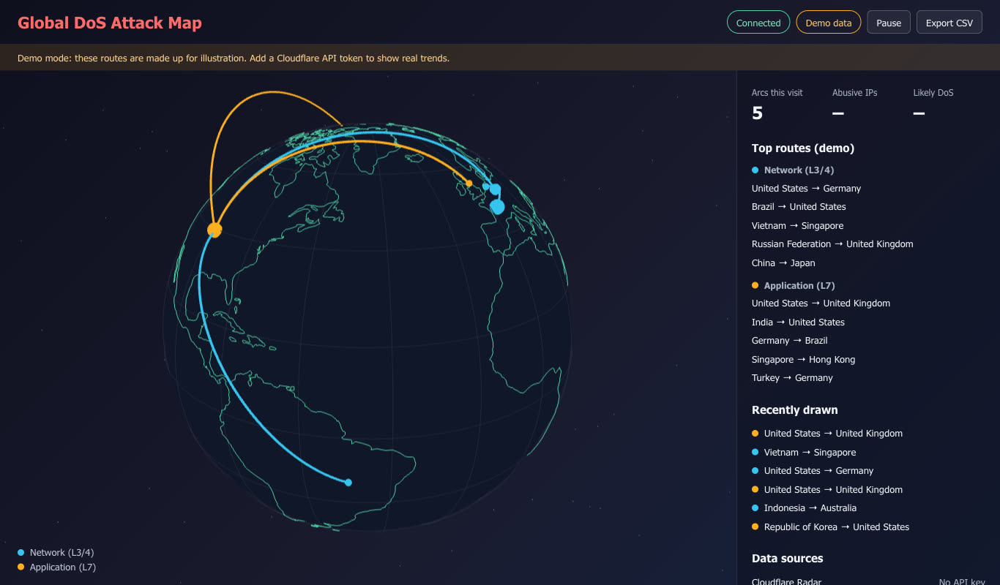
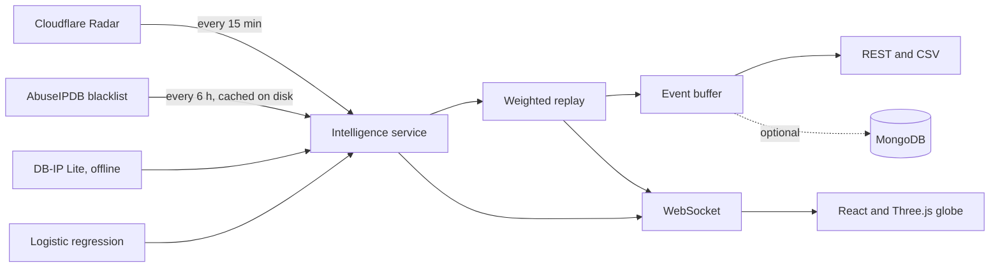

# Global DoS Attack Map

A real-time globe of denial-of-service trends. It replays country-to-country attack routes from
[Cloudflare Radar](https://radar.cloudflare.com/), plots abusive IPs from
[AbuseIPDB](https://www.abuseipdb.com/) at their approximate location, and can train a classifier
that ranks which of those IPs are likely DoS sources.

It runs without any API keys in a clearly labeled demo mode.



## What is real

| On screen | Source | What it means |
|---|---|---|
| Arcs and route shares | Cloudflare Radar, last 24 hours, refreshed every 15 minutes | Samples of country-level trends, weighted by share. An arc is not one live attack. |
| Attack vectors | Cloudflare Radar | Share of network-layer attacks by technique. |
| Dots | AbuseIPDB blacklist, refreshed every 6 hours | IPs reported for any kind of abuse, shown as /24 or /48 networks. |
| Red dots | The classifier | IPs the model ranks as likely DoS sources. Only shown after you train it. |
| Demo mode | Built-in illustrative routes | Made up. Always labeled as demo. |

Network-layer origins are the Cloudflare data center country that received the traffic, because
source IPs in those attacks can be spoofed. Radar publishes no IPs and AbuseIPDB publishes no
victims, so the two datasets are drawn separately and never joined into fake attacker-to-victim pairs.

## Architecture



- **Backend:** Node.js, Express 5, `ws`, optional MongoDB through Mongoose
- **Frontend:** React 19, Vite, Three.js
- **ML:** logistic regression in plain JavaScript, trained offline
- **Delivery:** one Docker image serving the API, WebSocket and UI, with a GitHub Actions pipeline

## Quick start

Needs Node.js 22.12 or newer.

```bash
cd backend
npm ci
cp .env.example .env     # keys are optional
npm run geo:update       # optional: city-level IP location, about 65 MB download
npm start                # http://127.0.0.1:5050
```

In a second terminal:

```bash
cd frontend
npm ci
npm run dev              # http://127.0.0.1:5173
```

To serve everything from port 5050, run `npm run build` in `frontend` and restart the backend.

### Docker

```bash
docker compose up --build --detach --wait
docker compose run --rm app node scripts/updateGeo.js   # optional
docker compose restart app                              # load the new database
```

## Configuration

Set these in `backend/.env`.

| Variable | Default | Purpose |
|---|---|---|
| `CLOUDFLARE_API_TOKEN` | empty | Custom token with only `Account > Radar > Read`. Never use a Global API Key. |
| `ABUSEIPDB_KEY` | empty | Enables threat dots and training. |
| `MONGODB_URI` | empty | Keeps replayed events for 3 days and restores them on restart. |
| `PORT` | `5050` | 5000 is taken by AirPlay on macOS. |
| `HOST` | `127.0.0.1` | Docker sets `0.0.0.0`. |
| `ALLOWED_ORIGINS` | empty | Other sites allowed to open the WebSocket. Same origin always works. |
| `TRUST_PROXY` | `0` | Number of reverse proxies in front. Set it correctly or rate limits apply to the proxy's IP. |

If you change `PORT`, start Vite with `BACKEND_URL=http://127.0.0.1:<port> npm run dev`.

## The classifier

**Question:** will this blacklisted IP have a "DDoS Attack" report (AbuseIPDB category 4)?

**Why a model:** labels need one `/check` call per IP and the free tier allows 1,000 a day, while the
blacklist has up to 10,000 IPs. The model scores all of them from data that costs no extra calls.

- **Features:** IP version, country, autonomous system, hosting or access-ISP keywords in the network
  name, and time since the last report. Report categories are the label and are never features.
- **Split:** 70/15/15 by /24 or /48 network, so neighboring IPs cannot leak into the test set.
- **Threshold:** chosen on validation by F0.5, which favors precision. The test set is only reported.
- **Guardrails:** training stops on too little data, and refuses to save a model whose average
  precision is under 1.2 times the positive rate.

```bash
cd backend
npm run geo:update     # required for the network features
npm run ml:collect     # up to 950 labels a run. Run it once a day for a few days
npm run ml:train       # prints held-out metrics and writes ml/model.json
```

No trained model or accuracy figure ships with this repository. Run the steps above and quote the
numbers you get. Scores rank IPs and are not calibrated probabilities. Labels are crowd-sourced
reports, so a missing DDoS report does not prove an IP is innocent.

## API

| Endpoint | Returns |
|---|---|
| `GET /health` | Liveness, data mode and the state of each source |
| `GET /events?limit=100` | Recently replayed events |
| `GET /stats` | Counts over the event buffer, plus source status |
| `GET /threats?limit=100` | Masked threat networks with optional scores |
| `GET /export?limit=100` | Events as CSV |
| `WS /ws` | `snapshot` on connect, then `event` and `state` messages |

`limit` accepts 1 to 1000. Data endpoints allow 120 requests a minute per IP.

## Tests

```bash
cd backend && npm test
cd frontend && npm run lint && npm test && npm run build
```

Upstream APIs are mocked in tests, using the shapes in their published documentation.

## Before deploying publicly

- Terminate TLS at a reverse proxy and set `TRUST_PROXY`.
- Run one instance. The event buffer, rate limits and quota schedule live in that process and its disk.
- `/health` is a liveness check and stays 200 when a data source fails. Alert on `mode`,
  `radar.state` and `abuse.state` in its body.
- Radar data is licensed for **non-commercial** use. Check AbuseIPDB's terms for your use case too.

## Credits

- Built by the contributors in this repository's
  [commit history](https://github.com/Aakash-legend/DDOS-Attack-Live-Map/graphs/contributors).
- Cloudflare Radar data, [CC BY-NC 4.0](https://creativecommons.org/licenses/by-nc/4.0/)
- [IP geolocation by DB-IP](https://db-ip.com/), CC BY 4.0
- Threat data by [AbuseIPDB](https://www.abuseipdb.com/)
- Country points and coastlines by [Natural Earth](https://www.naturalearthdata.com/), public domain
